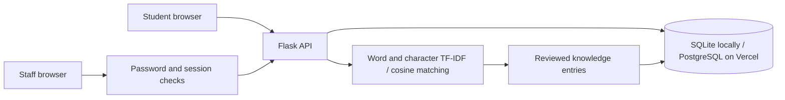

# Campus Companion — Student Support Chatbot

A Python/Flask final-year project that helps students navigate academic and administrative questions. The responsive interface works on desktop and mobile. The retrieval engine combines word and character TF-IDF with cosine similarity, conservatively falling back when a question is unclear. It does not require an external AI subscription.

## Features

- Twelve guidance topics: registration, fees, transcripts, examinations, results, admissions, housing, scholarships, study skills, portal access, human support and wellbeing.
- Typo-tolerant intent matching, greetings and out-of-scope clarification.
- Anonymous, session-scoped conversation history with helpful/not-helpful feedback and server-side deletion.
- Password-protected staff workspace at `/admin`: aggregate metrics, response/source editing and matching-example editing.
- SQLite for local development; PostgreSQL for persistent Vercel deployment.
- Input limits, parameterized database operations, CSRF checks, secure production cookies, content security policy and safe text rendering.

This is a demonstrator with general guidance, not an official institutional service. It cannot access student records, verify current deadlines, submit payments, send emails or create support tickets. Staff should replace general answers with verified institutional information before an institutional launch. The old prototype's 30 March deadline was unverified and is no longer asserted as a real deadline.

See [validation results](docs/VALIDATION.md), [desktop screenshot](docs/screenshots/desktop.png) and [mobile screenshot](docs/screenshots/mobile.png).

**Production deployment:** https://student-support-chatbot-one.vercel.app

## Run locally

Requires Python 3.12.

```sh
python -m venv .venv
. .venv/bin/activate
pip install -r requirements-dev.txt
python app.py
```

For a local production-server check:

```sh
gunicorn --bind 127.0.0.1:5000 --workers 1 --threads 4 app:app
```

On Windows, activate `.venv\Scripts\activate` and use `python app.py` for development. Do not reuse the Windows virtual environment from the original ZIP on Linux.

The local database is created automatically in `instance/chatbot.sqlite3` (ignored by Git). `DATABASE_PATH` can override its location. For stable sessions across restarts, set a private `SECRET_KEY` in your process environment. `.env.example` documents settings; the application does not automatically load `.env` files.

Staff access is disabled by default. Set `ADMIN_PASSWORD` to a private password of at least 12 characters, or set `ADMIN_PASSWORD_HASH` to the hash generated privately by `python scripts/admin_password.py`. If both are present, the hash takes precedence. Never commit a password, connection URL, hash, session key or `.env` file.

## Tests and evaluation

```sh
python -m pytest -q
python scripts/evaluate.py --output docs/evaluation-results.json --check
# In another terminal while the local server is running, on a machine with Chromium:
python scripts/browser_smoke.py
# Verify the production HTTP workflow (standard-library TLS validation):
BASE_URL=https://student-support-chatbot-one.vercel.app python scripts/http_smoke.py
```

The browser script uses `/usr/bin/chromium` in this development environment. Set `BASE_URL` to test another instance. It checks chat, feedback, history reload, deletion, HTML-injection safety, mobile overflow and the staff sign-in page. Development browser screenshots are not included in the source package.

The recorded development benchmark has **44 manually authored questions**, with **43 correctly classified (97.73%)** in the recorded run. The cases were used during development and tuning, so this score is **not an independent held-out evaluation or a real-world accuracy estimate**. The remaining error confuses a bursary request mentioning tuition with fee payment. Full per-question outcomes and local engine timings are in `docs/evaluation-results.json`. Timings exclude hosting cold starts, database operations and network latency.

The supplied write-up's 200-query / 85% accuracy and 90% satisfaction claims were not backed by datasets or survey responses in the uploaded implementation. They are not presented as verified findings here. See `docs/PROJECT_ALIGNMENT.md` for what to update and how to run a defensible final evaluation.

## Deploy to Vercel

The application exports `app` from `app.py`; Vercel detects Flask. `public/static` contains CDN-served assets, and `.python-version` selects Python 3.12. `vercel.json` sets the function duration and excludes development files.

1. Import `devAdura/student-support-chatbot` into Vercel, or link it using the Vercel CLI. Production branch: `main`.
2. Connect a **Neon Free PostgreSQL database** through Vercel Marketplace. Review and accept the provider's terms yourself. Connect its `DATABASE_URL` to Production and Preview. Use isolated databases for preview deployments when handling real data.
3. Set a securely generated `SECRET_KEY` as a sensitive environment variable. Generate it locally with `python -c "import secrets; print(secrets.token_hex(32))"` without posting it in chat or source control.
4. Set `ADMIN_PASSWORD` securely in Vercel, or use `ADMIN_PASSWORD_HASH`. Vercel automatically enables secure session cookies. Database TLS certificate and hostname verification are enforced; the bundled Mozilla CA certificates are used unless a trusted `sslrootcert` is supplied.
5. Deploy the `main` branch. Verify `/healthz`, ask a course-registration question, reload and confirm history, submit feedback, clear history, then test staff sign-in and a guidance update.

The app intentionally refuses to start on Vercel without `SECRET_KEY` and `DATABASE_URL`. Local SQLite is not a durable database on serverless hosting. The database schema is initialized automatically and knowledge entries are seeded without overwriting staff edits. PostgreSQL initialization is serialized with an advisory lock for concurrent cold starts.

The built-in request throttle is per running process. For an institutional production launch, configure shared/platform rate limiting, monitoring, backups and a retention policy. Data is retained until deletion; closing a browser session does not delete its records. The staff interface shows aggregate metrics and guidance, not raw student conversations.

## Architecture



The `users` table contains anonymous session identifiers, `queries` stores questions, `responses` stores answers, intent scores, engine processing time and feedback, and `knowledge` stores staff-editable examples and guidance. User identifiers are not student identities. Confidence values are similarity scores, not calibrated probabilities. Staff updates improve a reviewed knowledge base; this system does not autonomously train itself on student messages.

## API

| Endpoint | Purpose |
| --- | --- |
| `GET /healthz` | Database connectivity and process health |
| `GET /api/topics` | Available support topics |
| `POST /api/chat` | Match a question and persist its response |
| `GET /api/history` | Current anonymous session's last 50 exchanges |
| `DELETE /api/history` | Delete this session's stored exchanges |
| `POST /api/feedback` | Rate an answer belonging to this session |
| `POST /api/admin/login` | Staff sign-in |
| `POST /api/admin/logout` | Staff sign-out |
| `GET /api/admin/data` | Staff-only metrics and knowledge entries |
| `PUT /api/admin/knowledge/<intent>` | Staff-only guidance, source and example editing |

Mutating requests require JSON and the session's `X-CSRF-Token`, supplied by the web interface. All model answers and user messages are rendered as text, not executable HTML.

## Tailwind and fluid interface styling

Tailwind CSS 4 utilities are compiled locally and committed as `public/static/css/tailwind.css`. The existing component stylesheet remains in `public/static/css/style.css`; there is no Tailwind browser CDN, extra runtime script, or CSS reset changing the Flask application.

For visual development, use Node.js 22 or newer:

```sh
npm ci --ignore-scripts
npm run build:css
# Live utility compilation while editing templates/JavaScript:
npm run watch:css
```

Edit `assets/tailwind.css` for Tailwind theme utilities. Regenerate and commit the compiled CSS whenever utility classes change. Production serves the committed files without requiring a Node process. Fluid sizing uses CSS `clamp()` and viewport-relative chat height, with accessible minimum text sizes. Newly sent messages animate, restored history does not animate, and `prefers-reduced-motion` disables decorative motion and smooth scrolling.
